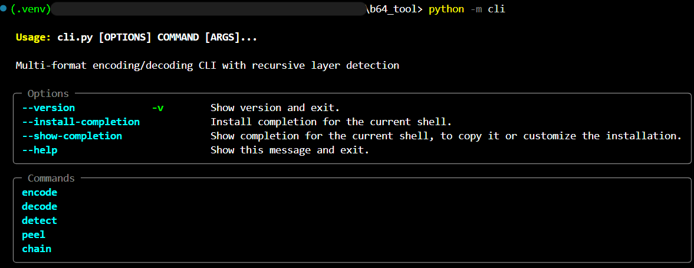
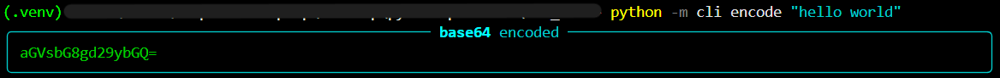
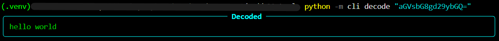
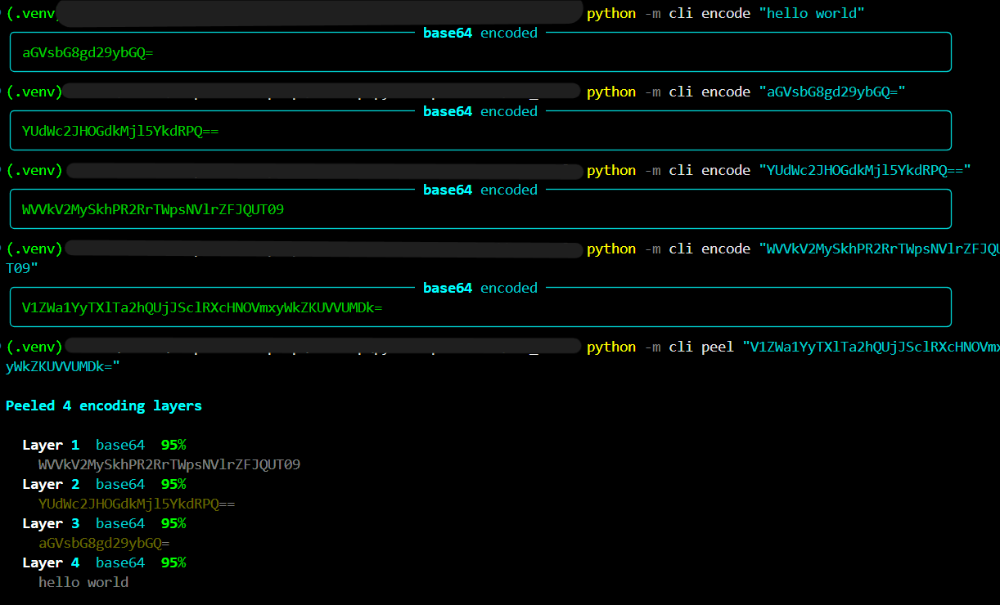
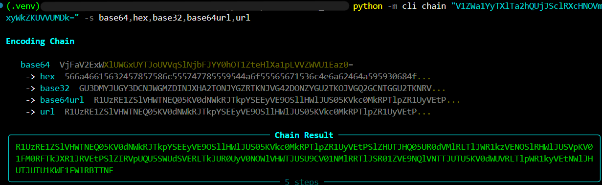
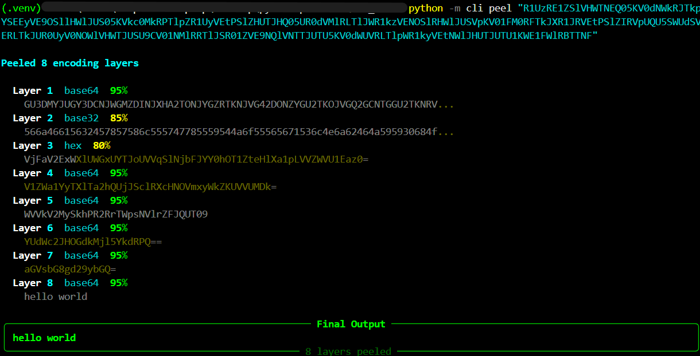

```text
©JimilPrabtani | 2026

 ██████╗  ██████╗ ██╗  ██╗████████╗ ██████╗  ██████╗ ██╗
 ██╔══██╗██╔════╝ ██║  ██║╚══██╔══╝██╔═══██╗██║   ██║██║
 ██████╔╝███████╗ ███████║   ██║   ██║   ██║██║   ██║██║
 ██╔══██╗██╔═══██╗╚════██║   ██║   ██║   ██║██║   ██║██║
 ██████╔╝╚██████╔╝     ██║   ██║   ╚██████╔╝╚██████╔╝███████╗
 ╚═════╝  ╚═════╝      ╚═╝   ╚═╝    ╚═════╝  ╚═════╝ ╚══════╝
  Multi-format encoder/decoder with recursive layer peeling
```


`b64tool` is a multi-format encoding and decoding command-line tool. It
supports Base64, URL-safe Base64, Base32, hexadecimal, and URL encoding. It
can also detect likely formats, recursively peel multiple encoding layers,
and apply a sequence of encoders as a chain.


## Features

- Encode and decode text using five formats:
  - `base64`
  - `base64url`
  - `base32`
  - `hex`
  - `url`
- Detect one or more likely encodings using confidence scoring.
- Show per-format scores with `detect --verbose`.
- Recursively decode layered input with `peel`.
- Encode data through multiple formats with `chain`.
- Read input from a command-line argument, a file, or standard input.
- Produce formatted Rich output in a terminal and raw output when piped.
- Use URL form encoding with `--form` when working with spaces and `+`.

## Version and requirements

- Current version: **0.1.0**
- Python: **3.12 or newer**
- Runtime dependencies:
  - [Typer](https://typer.tiangolo.com/)
  - [Rich](https://rich.readthedocs.io/)

Python 3.12 or newer is required because the source uses modern type-alias
syntax and other current Python typing features.

## Installation

Clone or copy the project, then open a terminal in the project directory:

```powershell
cd "C:\path\to\b64_tool"
```

Create and activate a virtual environment:

```powershell
python -m venv .venv
.\.venv\Scripts\Activate.ps1
```

Install the runtime dependencies:

```powershell
python -m pip install typer rich
```

The project currently runs as a module from the project directory. The
commands in this README use the virtual-environment interpreter directly, so
activation is optional:

```powershell
.\.venv\Scripts\python.exe -m cli --help
```


## General command format

```text
python -m cli [OPTIONS] COMMAND [ARGS]...
```

When using the included virtual environment on Windows:

```powershell
.\.venv\Scripts\python.exe -m cli [OPTIONS] COMMAND [ARGS]...
```

Use `--help` at any level to see the available options:

```powershell
.\.venv\Scripts\python.exe -m cli --help
.\.venv\Scripts\python.exe -m cli encode --help
```

Use `--version` or `-v` to display the current version:

```powershell
.\.venv\Scripts\python.exe -m cli --version
```

## Commands

### `encode`

Encode text or file input. Base64 is the default format.

```powershell
.\.venv\Scripts\python.exe -m cli encode "hello world"
```


Choose a format with `--format` or `-f`:

```powershell
.\.venv\Scripts\python.exe -m cli encode "hello world" --format base32
.\.venv\Scripts\python.exe -m cli encode "hello world" -f hex
.\.venv\Scripts\python.exe -m cli encode "hello world" -f base64url
.\.venv\Scripts\python.exe -m cli encode "hello world" -f url
```

Read the input from a file:

```powershell
.\.venv\Scripts\python.exe -m cli encode --file ".\input.txt" --format base64
```

For URL form encoding, use `--form`:

```powershell
.\.venv\Scripts\python.exe -m cli encode "hello world" -f url --form
```

### `decode`

Decode text or file input. Base64 is the default format.

```powershell
.\.venv\Scripts\python.exe -m cli decode "aGVsbG8gd29ybGQ="
```


Specify the source format:

```powershell
.\.venv\Scripts\python.exe -m cli decode "JBSWY3DPEBLW64TMMQ======" -f base32
.\.venv\Scripts\python.exe -m cli decode "68656c6c6f" -f hex
.\.venv\Scripts\python.exe -m cli decode "hello%20world" -f url
```

Decode URL form data with `--form`:

```powershell
.\.venv\Scripts\python.exe -m cli decode "hello+world" -f url --form
```

### `detect`

Analyze input and report formats whose confidence reaches the configured
threshold.

```powershell
.\.venv\Scripts\python.exe -m cli detect "SGVsbG8gV29ybGQ="
```

Example result:

```text
Format     Confidence   Decoded Preview
base64     95%          Hello World
```

Use `--verbose` or `-V` to show the score for every supported format:

```powershell
.\.venv\Scripts\python.exe -m cli detect "SGVsbG8gV29ybGQ=" --verbose
```

Input can also come from a file:

```powershell
.\.venv\Scripts\python.exe -m cli detect --file ".\encoded.txt"
```

### `peel`

Recursively detect and decode multiple encoding layers. The default maximum
depth is 20 layers.

```powershell
.\.venv\Scripts\python.exe -m cli peel "aGVsbG8gd29ybGQ="
```



Limit the number of layers with `--max-depth` or `-d`:

```powershell
.\.venv\Scripts\python.exe -m cli peel "aGVsbG8gd29ybGQ=" --max-depth 5
```

Show score details at every layer with `--verbose` or `-V`:

```powershell
.\.venv\Scripts\python.exe -m cli peel "aGVsbG8gd29ybGQ=" --verbose
```

### `chain`

Apply multiple encoders in sequence. Each step receives the previous step's
output.

```powershell
.\.venv\Scripts\python.exe -m cli chain "hello" --steps base64,hex
```


This performs:

```text
hello
  -> base64: aGVsbG8=
  -> hex:    614756736247383d
```

The final value is:

```text
614756736247383d
```

The short option is `-s`:

```powershell
.\.venv\Scripts\python.exe -m cli chain "hello" -s base64,base32,hex
```

All supported formats can be combined:

```powershell
.\.venv\Scripts\python.exe -m cli chain "hello" -s base64,hex,base32,base64url,url
```

Read chain input from a file:

```powershell
.\.venv\Scripts\python.exe -m cli chain --file ".\input.txt" -s base64,hex
```
Peeled the chain putput with `peel command`:



### Standard input and pipelines

If no argument or `--file` is supplied, the tool reads from standard input
when input is piped:

```powershell
Get-Content -Raw .\input.txt | .\.venv\Scripts\python.exe -m cli encode -f base64
```

Piped output is emitted without the terminal panels, making command chaining
with other tools possible:

```powershell
.\.venv\Scripts\python.exe -m cli encode "hello" |
    .\.venv\Scripts\python.exe -m cli decode
```

## Supported formats

| Format | Encode | Decode | Notes |
| --- | :---: | :---: | --- |
| `base64` | Yes | Yes | Standard Base64 with validation during decoding |
| `base64url` | Yes | Yes | URL-safe Base64 using `-` and `_` |
| `base32` | Yes | Yes | Base32 input is normalized to uppercase while decoding |
| `hex` | Yes | Yes | Hex input may contain spaces, `:`, `-`, or `.` separators |
| `url` | Yes | Yes | Percent-encoding; use `--form` for form-style `+` spaces |

## Exit codes

| Code | Name | Meaning |
| ---: | --- | --- |
| `0` | `SUCCESS` | Command completed successfully |
| `1` | `FAILURE` | Encoding, decoding, or processing failed |
| `2` | `INVALID_INPUT` | Reserved for invalid input handling |

## Project structure

```text
b64_tool/
├── assests/              # CLI screenshots (directory name kept as-is)
├── cli.py                # Typer application and command definitions
├── constants.py          # Formats, thresholds, limits, and score weights
├── detector.py           # Encoding detection and confidence scoring
├── encoders.py           # Encoding/decoding implementations
├── formatter.py          # Rich terminal output and piped output
├── peeler.py             # Recursive encoding-layer peeling
├── utils.py              # Input resolution and output helpers
├── tests/                # Regression tests
├── __init__.py           # Package metadata and version
└── README.md             # Project documentation
```

## Detection and peeling behavior

Detection is heuristic rather than a guarantee that an input has one unique
encoding. The detector:

1. Normalizes the input where the format allows it.
2. Checks character sets and format-specific structural rules.
3. Attempts a real decode.
4. Adds confidence for successful and printable results.
5. Reports results at or above the confidence threshold of `0.60`.

`peel` repeatedly selects the highest-confidence detected format, decodes one
layer, and uses the decoded UTF-8 text as the next input. It stops when no
format meets the threshold, decoding produces non-text bytes, or the maximum
depth is reached.

## Troubleshooting

### `b64tool` is not recognized

The project does not currently install a global `b64tool` executable. Run the
module from the project directory instead:

```powershell
.\.venv\Scripts\python.exe -m cli --help
```

Do not include `.py` after the module name. Use `-m cli`, not `-m cli.py`.

### The command exits without output

Make sure the current directory is the project directory and that the command
includes the module entry point:

```powershell
cd "C:\path\to\b64_tool"
.\.venv\Scripts\python.exe -m cli --help
```

### Invalid format

Format names are lowercase and must be one of:

```text
base64, base64url, base32, hex, url
```

For example:

```powershell
.\.venv\Scripts\python.exe -m cli encode "hello" -f base64
```

## Tests

Run the regression tests with the virtual-environment interpreter:

```powershell
.\.venv\Scripts\python.exe -m unittest discover -s tests -p "test_*.py"
```